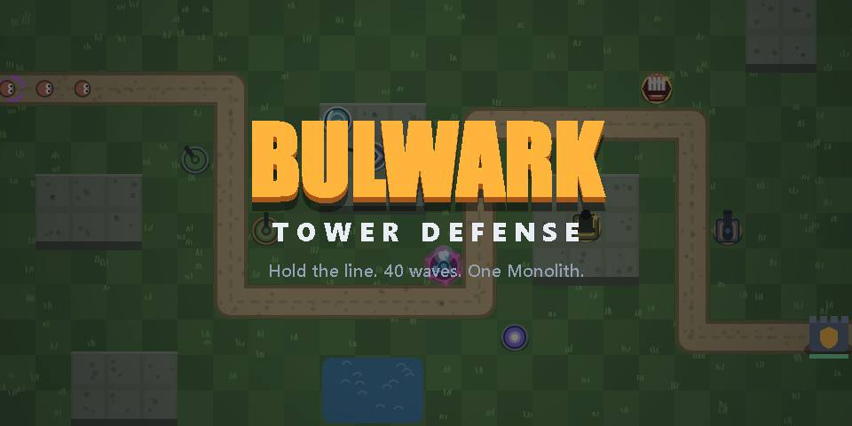
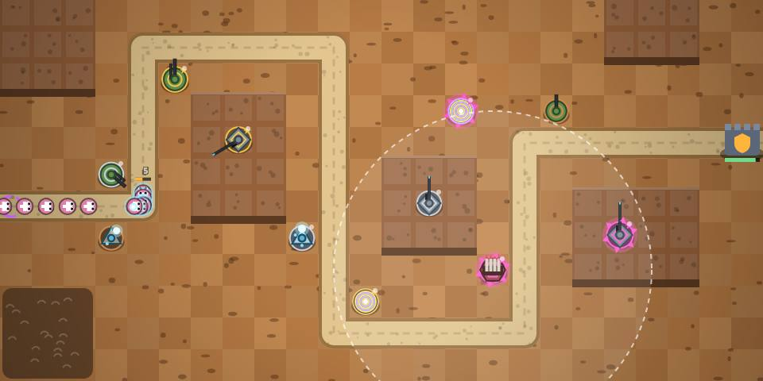
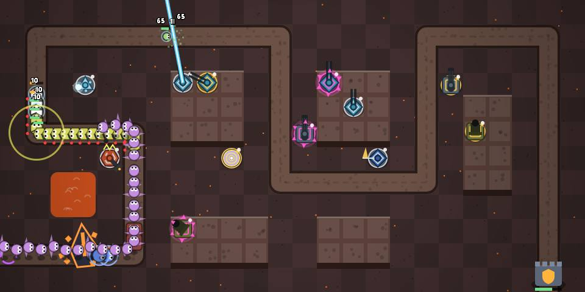
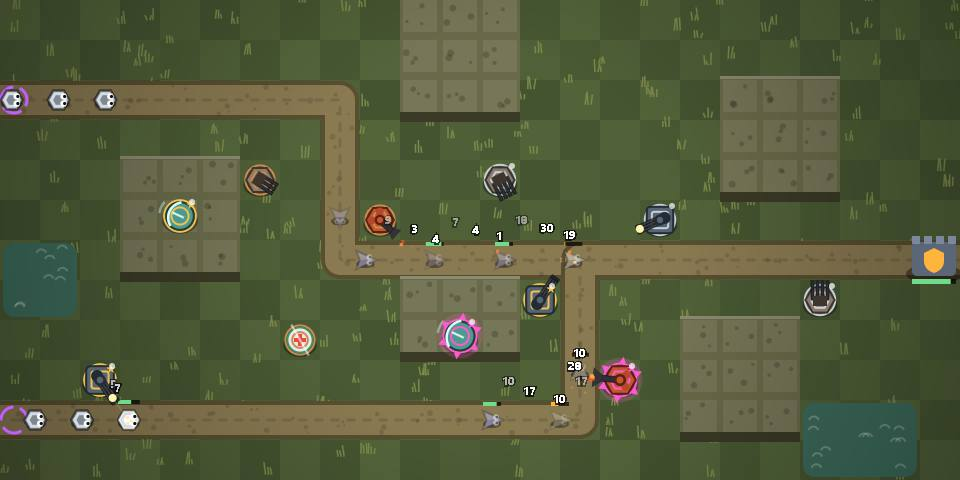
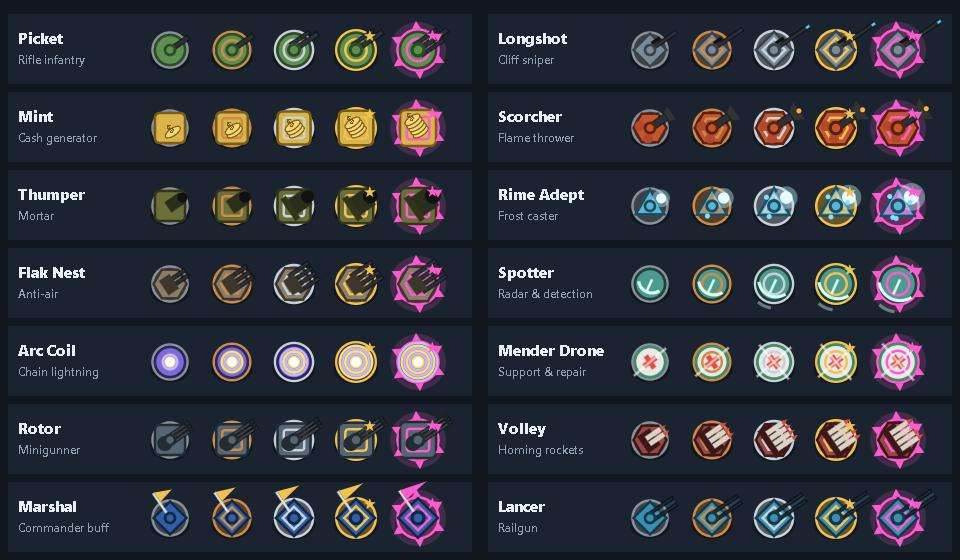

<div align="center">

# 🛡️ BULWARK TDS

### Hold the line. 40 waves. One Monolith.

An original **unit-placement tower defense** for the browser: build a 5-unit loadout, deploy squads on ground and cliff tiles, upgrade them through 4 visible ranks and survive 40 waves ending in a three-phase boss.

[](https://jaigod.github.io/bulwark-tds/)
[](https://github.com/JaiGod/bulwark-tds/releases/latest)


**[▶ Play now](https://jaigod.github.io/bulwark-tds/)** · **[📦 Download APK](https://github.com/JaiGod/bulwark-tds/releases/latest)** · **[🧾 Source](https://github.com/JaiGod/bulwark-tds)** · **[⚙️ Build workflow](https://github.com/JaiGod/bulwark-tds/actions)** · **[🏰 JaiGod org](https://github.com/JaiGod)**

<a href="https://jaigod.github.io/bulwark-tds/"></a>

</div>

## 📸 Screenshots

| Rustbowl Canyon, wave 16 | The Monolith, phase 2 |
|---|---|
| [](https://jaigod.github.io/bulwark-tds/) | [](https://jaigod.github.io/bulwark-tds/) |
| **Bogwater Locks: two lanes on Hard** | **All 14 units, levels 0 to 4** |
| [](https://jaigod.github.io/bulwark-tds/) | [](docs/screenshots/units.jpg) |

*All screenshots are captured from the live game canvas. Every sprite is drawn in code.*

---

## ✨ Features

| | |
|---|---|
| 🎖️ **14 original units** | Picket, Longshot, Mint, Scorcher, Thumper, Rime Adept, Flak Nest, Spotter, Arc Coil, Mender Drone, Rotor, Volley, Marshal, Lancer |
| ⬆️ **4 upgrade levels each** | Every level changes the sprite: tier-colored base ring, armor plate, extra barrels, rank star and a glowing aura at max |
| ⚡ **14 abilities** | Frag Toss, Deadeye, Payday, Inferno, Barrage, Deep Freeze, Skyburst, Flare, Overload, Patch, Overdrive, Salvo, Rally, Overcharge (unlock at level 2, on cooldown) |
| 🎯 **Targeting modes** | First / Last / Strong / Close per unit |
| 🧱 **Ground & cliff placement** | Snipers, mortars, railguns and radar need high ground; infantry needs open ground |
| 👾 **12 enemy types** | Grunt, Dasher, Brute, Plated (armored), Wisp & Phantom (hidden), Glider (flying), Splitter + Splitling, Tender (healer), Aegis (shielded), Jammer (disables units) |
| 💀 **Bosses** | Juggernaut, Warlord and Skyreaver mini-bosses, plus **The Monolith**: phase 1 summons brutes, phase 2 hardens and jams your units, phase 3 speeds up and cloaks |
| 🗺️ **6 maps** | Meadow Gate, Rustbowl Canyon, Glacier Spine, Cinder Foundry, Bogwater Locks (2 lanes), Stormcrown Keep (2 lanes) |
| 🎚️ **4 modes** | Easy, Normal, Hard (earlier threats, tougher HP) and Endless (boss every 10 waves) |
| 🪙 **Meta progression** | Coins per run, unit shop, XP levels with level-up rewards, 3 daily quests |
| 🎁 **Crates & skins** | 3 crate tiers, 8 cosmetic skins in 3 rarities. Coins are **earned in-game only**; there are no real-money purchases |
| 💥 **Juice** | Particles, damage numbers, screen shake, muzzle flashes, chain lightning, railgun beams, wave-start horn, 1x/2x/3x speed |
| 🎵 **Procedural audio** | WebAudio battle music (switches to a faster boss track) and synthesized sound effects. No audio files |
| 💾 **Saves** | Profile in localStorage; your run auto-saves between waves, so **Continue run** works after a reload |
| 📱 **Mouse + touch** | Plays on desktop and phones (landscape recommended), no horizontal scroll at 390px |

## 🎮 Controls

| Action | Mouse / touch | Keyboard |
|---|---|---|
| Pick a unit | Tap a card in the bottom bar | `1`–`5` |
| Deploy | Click / tap a highlighted tile | |
| Select a unit | Click / tap it | |
| Upgrade / Sell | Panel buttons | `U` / `X` |
| Targeting mode | Panel button | `T` |
| Ability | Panel button | `Q` |
| Start / skip wave | Wave button | `Space` |
| Speed 1x/2x/3x | Speed button | `F` |
| Pause | Pause button | `P` / `Esc` |
| Cancel | Right-click | `Esc` |

## 🧠 Tips

- **Wave 7 brings hidden Wisps.** Upgrade a Picket to level 2, a Longshot to level 2, or bring a Spotter.
- **Flyers** appear from wave 9. Pickets, Longshots, Rime, Flak, Rotor, Volley and Lancer can hit air.
- **Mints** pay out at the end of every wave. Build them early, protect them late.
- A **Mender Drone** next to your line makes nearby units immune to Jammers and the Monolith's shockwave.

## 🛠️ Tech stack

- Vanilla JavaScript and HTML5 Canvas 2D, no frameworks and no build step
- WebAudio API for all music and sound
- Procedural art: every unit, enemy and map is drawn in code
- [Capacitor](https://capacitorjs.com/) + GitHub Actions to package the same web build as an Android APK

## 🔗 Links

| | |
|---|---|
| 🎮 Play in browser | https://jaigod.github.io/bulwark-tds/ |
| 📦 Android APK (Releases) | https://github.com/JaiGod/bulwark-tds/releases/latest |
| ⚙️ APK build runs | https://github.com/JaiGod/bulwark-tds/actions |
| 🧩 Game data, units & art | [data.js](data.js) |
| 🧠 Engine, waves & UI | [game.js](game.js) |
| 🖥️ Page & styles | [index.html](index.html) |
| 🤖 CI workflow | [.github/workflows/android.yml](.github/workflows/android.yml) |
| 🖼️ Screenshots folder | [docs/screenshots](docs/screenshots) |
| 📜 License | [LICENSE](LICENSE) |

## 📁 Project structure

```
bulwark-tds/
├── index.html                    # Layout, menus, HUD and styles
├── data.js                       # Units, enemies, maps, modes, skins, quests + procedural art & audio
├── game.js                       # Simulation, waves, targeting, abilities, rendering loop, UI, saves
├── .github/workflows/android.yml # Capacitor build -> BulwarkTDS.apk on release v1.0.0
├── docs/screenshots/             # README images captured from the game canvas
├── LICENSE
└── README.md
```

## 🚀 Run locally

```bash
git clone https://github.com/JaiGod/bulwark-tds.git
cd bulwark-tds
python3 -m http.server 8000
# open http://localhost:8000
```

Or just open `index.html` in a browser. The game makes no network requests.

## 📓 Development log

**Design goal.** I wanted a tower defense that feels like the Roblox "TDS"-style games I play, where you deploy *units* instead of fixed towers, but built from scratch with its own units, enemies and look. My earlier game Slimefall TD is a cute slime defense, so Bulwark goes the other way: a military-industrial theme, cliffs vs. ground placement, loadouts, abilities and a real meta-progression loop.

**Data-driven units.** Each unit is a small record in `data.js`: base stats plus four upgrade deltas such as `{dmg:5, det:1}`. One `stat()` function folds the deltas, so balancing a unit means editing one line. The upgrade panel turns the same deltas into text ("Next: +5 dmg, detection").

**Upgrades you can see.** One `drawUnit()` function draws all 14 units from a body shape plus a weapon type, and the level adds layers on top: base ring color (iron, bronze, silver, gold, magenta), inner armor plate, more and longer barrels, a rank star, then a pulsing aura with spikes. Skins only swap the two palette colors, so every skin works on every unit.

**Waves.** Waves are generated from a seeded RNG, so every map and mode always gets the same waves. A budget grows with the wave number and is spent on enemy groups. When a new enemy type unlocks, the first group of that wave is that type, and the wave toast warns you ("NEW: Wisp (hidden!)"). Mini-bosses are fixed on waves 10, 20, 25, 30 and 35.

**Balancing with a bot.** I wrote a greedy Playwright bot that deploys and upgrades units and fires abilities, then ran full 40-wave games at max simulation speed. The first version died on wave 7 every time: hidden Wisps came in large groups and detection was too expensive. Fixes: Picket gets detection at level 2, hidden enemies cost more wave budget, the economy got about 50% richer, and HP scaling got steeper so the late game still pushes back. Now the bot usually clears Easy, sometimes beats Normal (it often loses to the Monolith), and loses early on Hard.

**Bugs I hit.**
- Auras read `unit.st` before the unit's first update, which crashed on the first frame. Fix: compute stats on placement.
- Fast units like Rotor and Scorcher created hundreds of damage numbers per second. Fix: each enemy collects damage and shows one number every 0.25s.
- The HUD covered the top row of the map on phones in landscape. Fix: the HUD became its own row instead of an overlay.
- Portrait phones make the map tiny, so the game shows a hint to turn the phone sideways, and the APK is locked to landscape.

**Saving.** The profile (coins, XP, units, skins, quests) and the current run are separate localStorage keys, and every access goes through `try/catch`. The run saves at each wave break (units, levels, targeting, cash, HP). Quest progress is applied after every wave and then reset, so continuing a run never counts a stat twice.

**Audio.** The battle music is a 4-bar minor loop (bass, kick, snare, hats and an arpeggio) scheduled ahead on the WebAudio clock. It gets quieter between waves and switches to a faster 138 BPM groove when a boss is on the field. The wave horn is three detuned sawtooth waves through a lowpass filter sweep.

**Beta tested on the live site ✅ (2026-11-05).** I opened https://jaigod.github.io/bulwark-tds/, clicked Play → Deploy, placed a Picket by tapping the map, started waves, paused and resumed, played until defeat, then pressed Play again. The canvas rendered, the run restarted cleanly, and the console showed zero errors.

## 🎮 More JaiGod games

| Game | What it is | Play |
|---|---|---|
| [Slimefall TD](https://github.com/JaiGod/slimefall-td) | My other, cuter tower defense | [▶ Play](https://jaigod.github.io/slimefall-td/) |
| [Orbit Sling](https://github.com/JaiGod/orbit-sling) | Neon gravity-slingshot puzzles | [▶ Play](https://jaigod.github.io/orbit-sling/) |
| [Neon Drift 3D](https://github.com/JaiGod/neon-drift-3d) | Synthwave 3D lane racer in raw WebGL | [▶ Play](https://jaigod.github.io/neon-drift-3d/) |
| [Nova Vanguard](https://github.com/JaiGod/nova-vanguard) | Unity arcade space shooter | [▶ Play](https://jaigod.github.io/nova-vanguard/) |
| [Glaze & Grind](https://github.com/JaiGod/glaze-and-grind) | Donut & coffee shop tycoon | [▶ Play](https://jaigod.github.io/glaze-and-grind/) |
| [Bloomfolk Gardens](https://github.com/JaiGod/bloomfolk-gardens) | Godot pixel-art gardening | [▶ Play](https://jaigod.github.io/bloomfolk-gardens/) |
| [Money Empire](https://github.com/JaiGod/money-empire) | 3D money & tycoon game | [▶ Play](https://jaigod.github.io/money-empire/) |
| [The Caretaker](https://github.com/JaiGod/the-caretaker) | First-person horror escape | [▶ Play](https://jaigod.github.io/the-caretaker/) |

See everything at **[github.com/JaiGod](https://github.com/JaiGod)**.

---

<div align="center">

Made by Jaineil Rana (JaKing) · part of [JaiGod](https://github.com/JaiGod)

</div>
<div align="center">

# 🛡️ BULWARK TDS

### Hold the line. 40 waves. One Monolith.

An original **unit-placement tower defense** for the browser: build a 5-unit loadout, deploy squads on ground and cliff tiles, upgrade them through 4 visible ranks and survive 40 waves ending in a three-phase boss.

[](https://jaigod.github.io/bulwark-tds/)
[](https://github.com/JaiGod/bulwark-tds/releases/latest)


</div>

---

## ✨ Features

| | |
|---|---|
| 🎖️ **14 original units** | Picket, Longshot, Mint, Scorcher, Thumper, Rime Adept, Flak Nest, Spotter, Arc Coil, Mender Drone, Rotor, Volley, Marshal, Lancer |
| ⬆️ **4 upgrade levels each** | Every level changes the sprite: tier-colored base ring, armor plate, extra barrels, rank star and a glowing aura at max |
| ⚡ **14 abilities** | Frag Toss, Deadeye, Payday, Inferno, Barrage, Deep Freeze, Skyburst, Flare, Overload, Patch, Overdrive, Salvo, Rally, Overcharge (unlock at level 2, on cooldown) |
| 🎯 **Targeting modes** | First / Last / Strong / Close per unit |
| 🧱 **Ground & cliff placement** | Snipers, mortars, railguns and radar need high ground; infantry needs open ground |
| 👾 **12 enemy types** | Grunt, Dasher, Brute, Plated (armored), Wisp & Phantom (hidden), Glider (flying), Splitter + Splitling, Tender (healer), Aegis (shielded), Jammer (disables units) |
| 💀 **Bosses** | Juggernaut, Warlord and Skyreaver mini-bosses, plus **The Monolith**: phase 1 summons brutes, phase 2 hardens and jams your units, phase 3 speeds up and cloaks |
| 🗺️ **6 maps** | Meadow Gate, Rustbowl Canyon, Glacier Spine, Cinder Foundry, Bogwater Locks (2 lanes), Stormcrown Keep (2 lanes) |
| 🎚️ **4 modes** | Easy, Normal, Hard (earlier threats, tougher HP) and Endless (boss every 10 waves) |
| 🪙 **Meta progression** | Coins per run, unit shop, XP levels with level-up rewards, 3 daily quests |
| 🎁 **Crates & skins** | 3 crate tiers, 8 cosmetic skins in 3 rarities. Coins are **earned in-game only**; there are no real-money purchases |
| 💥 **Juice** | Particles, damage numbers, screen shake, muzzle flashes, chain lightning, railgun beams, wave-start horn, 1x/2x/3x speed |
| 🎵 **Procedural audio** | WebAudio battle music (switches to a faster boss track) and synthesized sound effects. No audio files |
| 💾 **Saves** | Profile in localStorage; your run auto-saves between waves, so **Continue run** works after a reload |
| 📱 **Mouse + touch** | Plays on desktop and phones (landscape recommended), no horizontal scroll at 390px |

## 🎮 Controls

| Action | Mouse / touch | Keyboard |
|---|---|---|
| Pick a unit | Tap a card in the bottom bar | `1`–`5` |
| Deploy | Click / tap a highlighted tile | |
| Select a unit | Click / tap it | |
| Upgrade / Sell | Panel buttons | `U` / `X` |
| Targeting mode | Panel button | `T` |
| Ability | Panel button | `Q` |
| Start / skip wave | Wave button | `Space` |
| Speed 1x/2x/3x | Speed button | `F` |
| Pause | Pause button | `P` / `Esc` |
| Cancel | Right-click | `Esc` |

## 🧠 Tips

- **Wave 7 brings hidden Wisps.** Upgrade a Picket to level 2, a Longshot to level 2, or bring a Spotter.
- **Flyers** appear from wave 9. Pickets, Longshots, Rime, Flak, Rotor, Volley and Lancer can hit air.
- **Mints** pay out at the end of every wave. Build them early, protect them late.
- A **Mender Drone** next to your line makes nearby units immune to Jammers and the Monolith's shockwave.

## 🛠️ Tech stack

- Vanilla JavaScript and HTML5 Canvas 2D, no frameworks and no build step
- WebAudio API for all music and sound
- Procedural art: every unit, enemy and map is drawn in code
- [Capacitor](https://capacitorjs.com/) + GitHub Actions to package the same web build as an Android APK

## 📁 Project structure

```
bulwark-tds/
├── index.html                    # Layout, menus, HUD and styles
├── data.js                       # Units, enemies, maps, modes, skins, quests + procedural art & audio
├── game.js                       # Simulation, waves, targeting, abilities, rendering loop, UI, saves
├── .github/workflows/android.yml # Capacitor build -> BulwarkTDS.apk on release v1.0.0
├── LICENSE
└── README.md
```

## 🚀 Run locally

```bash
git clone https://github.com/JaiGod/bulwark-tds.git
cd bulwark-tds
python3 -m http.server 8000
# open http://localhost:8000
```

Or just open `index.html` in a browser. The game makes no network requests.

## 📓 Development log

**Design goal.** I wanted a tower defense that feels like the Roblox "TDS"-style games I play, where you deploy *units* instead of fixed towers, but built from scratch with its own units, enemies and look. My earlier game Slimefall TD is a cute slime defense, so Bulwark goes the other way: a military-industrial theme, cliffs vs. ground placement, loadouts, abilities and a real meta-progression loop.

**Data-driven units.** Each unit is a small record in `data.js`: base stats plus four upgrade deltas such as `{dmg:5, det:1}`. One `stat()` function folds the deltas, so balancing a unit means editing one line. The upgrade panel turns the same deltas into text ("Next: +5 dmg, detection").

**Upgrades you can see.** One `drawUnit()` function draws all 14 units from a body shape plus a weapon type, and the level adds layers on top: base ring color (iron, bronze, silver, gold, magenta), inner armor plate, more and longer barrels, a rank star, then a pulsing aura with spikes. Skins only swap the two palette colors, so every skin works on every unit.

**Waves.** Waves are generated from a seeded RNG, so every map and mode always gets the same waves. A budget grows with the wave number and is spent on enemy groups. When a new enemy type unlocks, the first group of that wave is that type, and the wave toast warns you ("NEW: Wisp (hidden!)"). Mini-bosses are fixed on waves 10, 20, 25, 30 and 35.

**Balancing with a bot.** I wrote a greedy Playwright bot that deploys and upgrades units and fires abilities, then ran full 40-wave games at max simulation speed. The first version died on wave 7 every time: hidden Wisps came in large groups and detection was too expensive. Fixes: Picket gets detection at level 2, hidden enemies cost more wave budget, the economy got about 50% richer, and HP scaling got steeper so the late game still pushes back. Now the bot usually clears Easy, sometimes beats Normal (it often loses to the Monolith), and loses early on Hard.

**Bugs I hit.**
- Auras read `unit.st` before the unit's first update, which crashed on the first frame. Fix: compute stats on placement.
- Fast units like Rotor and Scorcher created hundreds of damage numbers per second. Fix: each enemy collects damage and shows one number every 0.25s.
- The HUD covered the top row of the map on phones in landscape. Fix: the HUD became its own row instead of an overlay.
- Portrait phones make the map tiny, so the game shows a hint to turn the phone sideways, and the APK is locked to landscape.

**Saving.** The profile (coins, XP, units, skins, quests) and the current run are separate localStorage keys, and every access goes through `try/catch`. The run saves at each wave break (units, levels, targeting, cash, HP). Quest progress is applied after every wave and then reset, so continuing a run never counts a stat twice.

**Audio.** The battle music is a 4-bar minor loop (bass, kick, snare, hats and an arpeggio) scheduled ahead on the WebAudio clock. It gets quieter between waves and switches to a faster 138 BPM groove when a boss is on the field. The wave horn is three detuned sawtooth waves through a lowpass filter sweep.

---

<div align="center">

Made by Jaineil Rana (JaKing) · part of [JaiGod](https://github.com/JaiGod)

</div>
